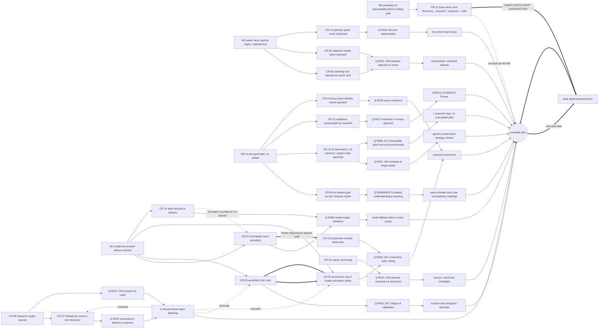

# Unified causal failure graph: lead draft v1 (to be challenged by Gate C)

**Edge types**
- `cause → mechanism → failed capability → consequence → FINAL`.
- Dotted edges conceal (one failure hides another from detection).
- Thick edges amplify (one failure makes another worse).

Node IDs match `ROOT-CAUSES.md` (CR-xx), `maps/C/requirements.json` (Q-Rxxx) and the experiments (E-xxx).

## Reading the graph

1. **Two independent entry failures, either of which alone yields an unusable plan:**
   - **INF.** No facts reach planning.
   - **M1 with MOD.** The model turn fails, or is answered by the weakest model.
   - Fixing either one alone leaves the other blocking. This is measured: supplying facts moved 0/3 to 0–1/3, and a strong model inside Brain's machinery scored 0/3.
2. **Hidden downstream failures, exposed by controlling upstream:**
   - CR-03 (critic), CR-04 (economics) and CR-07 (selection) were invisible in production because no facts arrived.
   - The supplied-facts experiments (30Q, E-002, E-010–E-012) exposed each of them independently. This is the owner's Section 11 "upstream conceals downstream" case.
3. **The feedback loop (CR-12 into LOOP into FINAL into LOOP)** explains the campaign history:
   - Repairs are tuned to the batch that failed and verified by component tests.
   - In E-010–E-016 the W1 repairs change little of the recorded failure, and E-002 on production still yields nothing.
4. **Structural ceiling (M3).** Even a good model-written route enters as one opening among project-wide constructed arrangements that read nothing of the owner. Deterministic selection then picks by assumption-only reach.
   - The live $10k reading at 05:40Z: chosen strategy only_o3, reach 0.97 with basis ASSUMPTION_ONLY, supported reach 0, committee FAIL.

## Correctly functioning paths (recorded so they are not "repaired")

These pass in Brain's own deterministic replays:
- **MARGIN, DEADLINE and CAPITAL single-sale parser rejections** (E-010 control).
- **REFUTED claims are filtered** (E-012).
- **Exact-duplicate dedupe** (E-012).
- **The empty-reply 2× retry, then fallback** (E-015).
- **Route-prompt lift for owners who offer labour** (E-014).
- **Tuned objective phrasings 7/7** (E-013).
- **The committee correctly blocks acceptance** on unsupported deal counts. This is observed on the live $10k reading and on wst_db2e.

Not re-verified here:
- **Verification of quotes against re-read pages.** It was an evaluation tool (30Q `verify.py`), not a production mechanism.

## Untested interactions (recorded, not silently passed)

- Research and planning feedback over multiple days on E1 (requires a live goal re-plan).
- Queue/worker recovery under DB contention while a goal is planning.
- GPU throttling (the event loop caps concurrency) interacting with the route-ask latency budget.
- Whether CR-13 affects any live goal (Map B pending).
